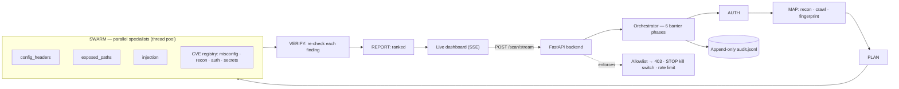

# VulnSwarm — Swarmageddon

A consent-first, non-destructive, allowlist-gated multi-agent web-vulnerability scanner. A swarm of specialist agents maps a target you own, probes it in parallel, re-verifies every finding against a fresh observation, and streams a ranked report to a live dashboard.

**It detects. It does not exploit.** Probes are small, deterministic markers (a reflected token, a single quote, `;id`, a traversal to `/etc/passwd`) used only to confirm that a weakness exists. The planner refuses to inject into destructive or sensitive fields (password, token, CSRF, delete/update/create/logout controls), and skips a whole form when it carries a destructive control (reset, clear, drop, delete, …), because probing any field also submits the form's other buttons.

## Tech stack

- **Backend:** Python 3, FastAPI + Uvicorn, Pydantic.
- **HTTP probing:** Python standard-library `urllib` only (no third-party scraper); every request is paced and allowlist-checked.
- **Concurrency:** `ThreadPoolExecutor` runs the specialist swarm in parallel over one shared `ScanContext`.
- **Streaming:** Server-Sent Events push every phase, agent and finding to the dashboard live.
- **Frontend:** a single-file vanilla HTML/CSS/JS dashboard — no build step.
- **Optional triage:** `openai` SDK pointed at a Featherless hosted model (off unless `FEATHERLESS_API_KEY` is set).
- **Storage:** an append-only JSONL audit log. No database.
- **Tests:** `pytest` (239 test functions).

## Architecture



## Pipeline

`backend/orchestrator.py` runs six phases as barriers. Each phase finishes before the next starts.

| Phase  | Module(s) | What happens |
|--------|-----------|--------------|
| AUTH   | `auth.py`, `recon.py` | One shared session. Logs in if the target is recognized (currently DVWA, lab creds from env). |
| MAP    | `recon.py`, `crawler.py`, `fingerprint.py` | Root recon, bounded same-host BFS crawl (pages, forms, params, no JS execution), evidence-based stack fingerprint. |
| PLAN   | `planner.py` | Pairs discovered sections with relevant specialists to produce work units (stack-aware, capped at 20 injection units). |
| SWARM  | `agents/config_headers.py`, `agents/exposed_paths.py`, `agents/injection.py`, `agents/cve_checks/` | Units run in parallel (thread pool, `MAX_WORKERS = 8`), all writing to one shared `ScanContext`. |
| VERIFY | `verifier.py` | Re-checks each finding on a fresh request: `confirmed`, `rejected`, or `unverified` (left for a human). |
| REPORT | `reporter.py` | Dedupes, assigns stable ids, ranks by verdict, then severity, then source (deterministic first). |

Specialists:
- **config_headers**: missing security headers, insecure cookies, version banners.
- **exposed_paths**: sensitive paths that are actually reachable. A random-path baseline, file-type checks, and content signatures suppress catch-all false positives (e.g. Juice Shop answers 200 for any path).
- **injection**: reflected XSS, error-based and boolean-blind SQLi, command injection, and LFI on one form field or query parameter.
- **CVE registry** (`misconfig`, `recon`, `auth`, `secrets`): one work unit per entry in `backend/agents/cve_checks/`. See **Exploited-CVE checks**.

## Safety guardrails

- **Server-side allowlist** (`ALLOWLIST` in `main.py`): an off-list host gets HTTP 403 and is never fetched. `/scan/stream` re-checks the allowlist inside the worker thread before calling the orchestrator. `GET /preview` returns a placeholder for off-list hosts without contacting them and does not follow redirects.
- **Kill switch** (`control.py`): `POST /scan/stop` with a `run_id` stops one scan; `all: true` (or no `run_id`) stops every in-flight scan. The stop flag is checked before every outbound request, so a stop takes effect mid-phase. A client disconnect also stops the scan.
- **Concurrency cap and pacing** (env vars):
  - `VULNSWARM_MAX_CONCURRENT_SCANS`: default `2`. Additional scans get HTTP 429.
  - `VULNSWARM_REQUEST_INTERVAL_MS`: default `50`. Minimum gap between requests within one scan.
  - `VULNSWARM_GLOBAL_REQUEST_INTERVAL_MS`: default `25`. Minimum gap between any two requests.
- **Append-only audit log** (`audit.py`): JSONL, one record per line, never rewritten. It records scan start, stop, reject, and outcome events, plus each outbound request (method, URL, status). Request bodies are not stored. Default path is `backend/var/audit.jsonl`; override it with `VULNSWARM_AUDIT_LOG`. `GET /audit` returns the newest records and the live limits.

## Exploited-CVE checks

These checks live in `backend/agents/cve_checks/` as a registry (`id`, CVE, agent, fixed versions, what the check sends). A later advisory is a new module plus one list entry, and for a dependency pin, one object in `vulnerable_pins.json`. Every request goes through `recon._do` (allowlist on redirects, kill switch, global rate limit, audit log). Version hits say **version appears vulnerable (unconfirmed)** and cite the fixed releases. They do not claim the bug was exploited.

| Check | Advisory | What it sends | What it does not send |
| --- | --- | --- | --- |
| `php2shell` (misconfig) | CVE-2026-109618 / CVE-2026-109619 | Nothing extra. Reads `PHP/x.y.z` from the root response already fetched (X-Powered-By, Server, or that token in the body). Critical below 8.5.12 / 8.4.27 / 8.3.36 / 8.2.35 on that branch, or when the branch is EOL (before 8.2). | No phpinfo request, no multipart body, no upload fields, no exploit payload. |
| `nextjs-rce` (misconfig) | GHSA-2464-fhr4-w9xw | Header, `/_next/` URL, or one GET of `/_next/static/<buildId>/_buildManifest.js` when a build id is on the page and the version is still hidden. Critical below 15.5.28 (15.x) or 16.4.1 (16.x). Info when Next.js is detected but the version is hidden. | No exploit payload, no RSC flight request, no POST. |
| `node-brotli` (misconfig) | CVE-2026-111497 | After a Node/Express/Bun header fingerprint, one POST of a small valid Brotli JSON body (`Content-Encoding: br`) only to a URL the crawler already saw answer a plain GET with 2xx JSON. Skips form actions, POST-only routes, and state-changing paths (login, register, signup, reset, delete, checkout, order, pay, upload, admin, and similar). Flags acceptance so the runtime can be checked (Node >= 22.23.4 / 24.22.1 / 26.12.1, Bun > 1.4.3). If no GET-verified JSON endpoint exists, the POST is not sent and the finding is Info. | No malformed or oversized stream, no second compressed body, no exploit payload. Verification does not send it again. |
| `wedevs-project-manager` (recon) | CVE-2026-116512 | GET `/wp-content/plugins/wedevs-project-manager/readme.txt`. Critical when the Stable tag is 4.1.1 or lower. If that readme is the plugin, one GET `/wp-json/pm/v2` and an Info note on whether the route index answers without login. | No login, no POST/PUT/DELETE, no exploit payload. |
| `nodered-admin` (auth) | CVE-2026-58115 | One GET `/settings`, and GET `/flows` only when `/settings` is not a Node-RED answer. Critical on HTTP 200 Node-RED JSON with no auth challenge: unauthenticated editor (`adminAuth` not set) means RCE. | Never POST `/flows`. No flow deploy, no exploit payload. |
| `wordpress-core` (misconfig) | CVE-2026-119977 (CISA KEV) | Generator meta tag or core `?ver=` already in the page, otherwise one GET `/readme.html`. Critical, marked actively exploited, for 4.7 through 7.1.3 (fixed in 7.1.4). | Never requests upgrade or staging paths (`update-core`, wp-admin upgrade, `/wp-content/upgrade`). |
| `dependency-files` (secrets) | CVE-2026-57845 and any later pin in `vulnerable_pins.json` | One baseline GET, then GET of `requirements.txt`, `poetry.lock`, `package-lock.json`, `yarn.lock`, `pnpm-lock.yaml`, `Pipfile.lock`, `composer.lock`, `Gemfile.lock`. Flags a public file, then any known-vulnerable pin. `datasets<=5.1.0` is an unpatched pickle RCE. | No install, no import, no pickle load, no POST. |
| `metabase` (recon) | CVE-2026-72898 (CVSS 10, KEV) | One GET `/api/session/properties`. Critical below 0.58.24 / 0.59.21 / 0.60.17 / 0.61.11 / 0.62.9 / 0.63.5 on that branch. | Never requests the password-reset route. No POST, no session token, no exploit payload. |
| `langflow` (auth) | CVE-2026-93680 / CVE-2026-110186 | GET `/api/v1/version`. Critical below 1.13.0. When the body is Langflow, GET `/api/v1/mcp` and GET `/api/v1/auto_login` and note whether tools are listed without login and whether auto-login answers. | Never uses a returned token, never runs a flow, no POST. The token is not copied into the finding. |
| `mlflow` (misconfig) | CVE-2026-4035 | One GET `/version`. High below 3.11.0 when that response has no auth challenge (suggests no basic-auth). Medium when basic-auth challenges, using the MLflow UI title or `/static-files` assets the crawl already stored if `/version` itself is only the challenge. | No POST, PUT, PATCH, or DELETE. No gateway route or secret create, modify, or list. No completion call. No `$ENV_VAR` string, credential, or external callback. |
| `supabase-storage` (misconfig) | GHSA-fgvp-cqg6-q8h2 / GHSA-3m3f-pjv4-x2fp | One GET `/storage/v1/version`. Critical when `<= 1.89.8` (RLS bypass via JWT role `none`). High on `1.89.9` for the sibling advisory only. `*.supabase.co` is informational (hosted already patched). Recommends `1.89.10+`. | No JWT (including role `none`), no Authorization or apikey header, no presigned URL, no `x-amz-copy-source`, no upload, no bucket create, no write, no exploit payload. |
| `magento-polyshell` (recon) | CVE-2026-48356 (APSB26-73) | Version from the root response, or one GET `/magento_version`. Critical for versions before 2.4.9. | No backdoor-path probing, no admin crawl, no exploit payload, no POST. |
| `yootheme-pro` (misconfig) | CVE-2026-102785 | Theme asset `?ver=` or a generator meta tag already in the page HTML. If that HTML was not stored, one GET of the in-scope page with no query string. Critical, version unconfirmed, for 5.0.0 through 5.0.52 (fixed in 5.0.53). Pro 4.x and earlier are not affected. Info when YOOtheme is present but the version is hidden. | Never requests the image handler or the cache endpoint. No FromFile or Save parameters, no php://input, no request body, no upload, no modified signed image URL, no path traversal, no webshell-name guessing, no POST. |
| `amelia-pro` (misconfig) | CVE-2026-116751 | `ameliabooking` asset `?ver=` already in the page HTML, otherwise one GET of `/wp-content/plugins/ameliabooking/readme.txt`. Critical, version unconfirmed, for Amelia Pro 4.0 through 9.9.1 (fixed in 9.9.2). Commercial/Pro is distinguished from WordPress.org Lite by the separate 4.0+ version line on the shared `ameliabooking` slug. Info when Amelia is present but Pro edition/version is unclear. Lite-only fingerprints never yield vulnerable. | Never requests Amelia event-filter or API routes. No `tag` parameters, no SQL, no timing probes, no exploit payloads, no malformed input, no POST. |
| `contact-form-7` (misconfig) | CVE-2026-114432 | Plugin asset `?ver=` already in the page HTML, or one GET `/wp-content/plugins/contact-form-7/readme.txt` Stable tag. High, version unconfirmed, for >= 6.2 and < 6.2.4 (6.2 through 6.2.3; fixed in 6.2.4+; 6.1.x and lower are not affected). When that version is in range, one GET `/wp-content/uploads/` (or a linked `wpcf7_uploads` folder); Critical if the response is an `Index of` autoindex listing (exposes the file-listing step behind the RCE path on stock Debian/Ubuntu Apache). Info when the plugin is present but the version is hidden. | No POST, no form submission, no file upload, no crafted or invalid-UTF-8 filenames, no attempt to fetch or execute an uploaded file, no attack payload, no malformed input. |
| `vite-dev-server` (misconfig) | GHSA-p4f5-76q4-ffq7 | Recon HTML already fetched for `/@vite/client` or `/@react-refresh`, otherwise one GET `/@vite/client` matching known Vite client markers (`[vite] connecting...`, `createHotContext`, `vite-hmr`, `data-vite-dev-id`). Critical when a Vite development server is publicly reachable: dev server exposed; any Vite below patched versions is vulnerable; never run the Vite development server in production. Affected: >=4.0.0 <=6.4.5, 7.0.0–7.3.7, 8.0.0–8.1.6, 8.2.0–8.2.4, 8.3.0–8.3.6; vite-plus <=1.5.0. Patched: 6.4.6, 7.3.8, 8.1.7, 8.3.7 (prefer over 8.2.5 if missing on npm); vite-plus 1.5.1; 4.x/5.x → >=6.4.6. Refines evidence when a Vite version is already visible (e.g. dependency_files output). | Never requests `/@id/__vite-browser-external`, `/@id/__vite-optional-peer-dep`, `/@fs/`, crafted or encoded module IDs, newline-injected URLs, advisory PoC paths, file-read attempts, writes, or malformed input. |

The Brotli body is a fixed encoding of `{"vulnswarm":"ok"}` (22 bytes). The `brotli` package is only used by tests to decode that constant; the scanner does not compress at request time.

## Triage: rule-based by default

All findings come from deterministic checks, and each carries a machine-checkable `check` that the verifier re-runs. **The scanner and the full test suite run rule-based.**

`backend/llm.py` is an **optional** hosted-LLM augmentation (Featherless, OpenAI-compatible; default model `Qwen/Qwen2.5-7B-Instruct`, override with `VULNSWARM_MODEL`). It is gated behind `llm.available()` and stays **off unless `FEATHERLESS_API_KEY` is set**. When it is on, it only triages header and cookie data the scanner already collected. The verifier grounds every AI finding by rejecting any whose cited evidence is not in the real response. The report's `ai_available` field shows whether it was active.

## API

| Endpoint | Purpose |
|----------|---------|
| `POST /auth/login` | Returns a bearer token (HMAC-signed, 8 h TTL; secret from `VULNSWARM_SESSION_SECRET`) |
| `POST /scan` | Blocking: runs the swarm and returns the finished report |
| `POST /scan/stream` | Same swarm, streamed as SSE: `scan_started`, `phase`, `agent`, `finding`, `verdict`, `scan_complete`, `error` |
| `POST /scan/stop` | Kill switch (one scan or all scans) |
| `GET /preview` | Allowlist-gated target preview for the dashboard |
| `GET /targets`, `/audit`, `/me`, `/health` | Lab targets, audit tail and limits, current user, liveness |

## Run it

```bash
cd backend
python -m venv .venv && source .venv/bin/activate
pip install -r requirements.txt
uvicorn main:app --port 8000
```

Open `dashboard/index.html`, sign in as `erwin@local` / `demo` (or `andrew@local` / `demo`), set the target, and press **SCAN**.

Tests (97 test functions in `backend/tests/`):

```bash
cd backend && python -m pytest tests/ -q
```

The demo users and the dev token secret are for localhost only. Set `VULNSWARM_SESSION_SECRET` and replace `USERS` before any shared use. Optionally set `VULNSWARM_CORS_ORIGINS` (comma-separated) to lock CORS to your dashboard origins; the default allows localhost/127.0.0.1 dashboard ports and a `file://` open (`null` origin).

## Demo targets

The intended targets are intentionally vulnerable apps that **you host yourself**: **OWASP Juice Shop** and **DVWA**. Both require **Docker** locally. `docker-compose.yml` runs them alongside the backend and dashboard:

- Juice Shop on `:3001`
- DVWA on `:8081` (its database is kept in the `dvwa-db` volume; create it once at `/setup.php`)
- backend on `:8000`
- dashboard on `:8090`

The `ALLOWLIST` in `main.py` is `localhost` and `127.0.0.1` only. LAN addresses are deliberately left out: on shared Wi-Fi a LAN IP can belong to someone else's device. Because the backend runs next to the targets, scan them as `http://localhost:8081` (DVWA) and `http://localhost:3001` (Juice Shop); those are the dashboard's `LAB_TARGETS` cards, and the backend routes them to the containers. Browsers on the LAN still open the dashboard and labs at the tower's address (e.g. `http://10.0.0.32:8090`), and the extension sends a tab on the backend's own machine as `localhost`. Only add a LAN host to `ALLOWLIST` on a private network you control. Keep these apps off the public internet. Scan only systems you own or are explicitly authorized to test.

For the live projector demo, follow [docs/DEMO_RUNBOOK.md](docs/DEMO_RUNBOOK.md). Teammate laptop setup: [SETUP.md](SETUP.md).

## Data & sources

Swarmageddon uses **no external datasets**. Its only inputs are the live HTTP responses of the single target you host and have consented to test; nothing is collected or trained on. Demo targets are the intentionally vulnerable **OWASP Juice Shop** and **DVWA** (upstream open-source projects you run locally via `docker-compose` — see **Demo targets**). The server-side allowlist guarantees no host outside your own lab is ever contacted.

## Known limitations & next steps

**Limitations today**
- The crawl does not execute JavaScript, so SPA-only routes and DOM-rendered links can be missed.
- Injection is capped at 20 work units per run to stay fast and polite.
- Specialists cover security headers / cookies / version banners, reachable sensitive paths, injection on one field at a time, and the exploited-CVE registry. The Brotli check only POSTs to a URL that already answered a plain GET with 2xx JSON during this scan, so an unlinked, POST-only, or form-only route is skipped.
- **Confirmation probes only** — it proves a weakness exists, it does not exploit, chain, or extract data.
- Authenticated scanning currently recognizes the DVWA login flow only.

**Next steps**
- Headless-browser crawl for single-page apps.
- More specialists: SSRF, IDOR, broken auth/session, CORS misconfig.
- Verifier-grounded LLM triage across more finding types.
- SARIF / shareable HTML report export.
- Scheduled re-scans with diffing to track a target over time.

## Team ALANI

- **Andrew Carvajal** — software developer
- **Erwin Pawliczek** — chemical engineer
