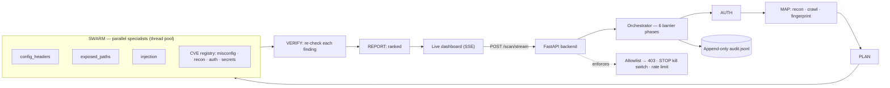

# VulnSwarm — Swarmageddon

A consent-first, non-destructive, allowlist-gated multi-agent web-vulnerability scanner. A swarm of specialist agents maps a target you own, probes it in parallel, re-verifies every finding against a fresh observation, and streams a ranked report to a live dashboard.

**It detects. It does not exploit.** Probes are small, deterministic markers (a reflected token, a single quote, `;id`, a traversal to `/etc/passwd`) used only to confirm that a weakness exists. The planner refuses to inject into destructive or sensitive fields (password, token, CSRF, delete/update/create/logout controls), and skips a whole form when it carries a destructive control (reset, clear, drop, delete, …), because probing any field also submits the form's other buttons.

## Tech stack

- **Backend:** Python 3, FastAPI + Uvicorn, Pydantic.
- **HTTP probing:** Python standard-library `urllib` only (no third-party scraper); every request is paced and allowlist-checked.
- **Concurrency:** `ThreadPoolExecutor` runs the specialist swarm in parallel over one shared `ScanContext`.
- **Streaming:** Server-Sent Events push every phase, agent and finding to the dashboard live.
- **Frontend:** a single-file vanilla HTML/CSS/JS dashboard — no build step.
- **Optional triage:** `openai` SDK pointed at a Featherless hosted model (off unless `FEATHERLESS_API_KEY` is set).
- **Storage:** an append-only JSONL audit log. No database.
- **Tests:** `pytest` (978 tests).

## Architecture



## Pipeline

`backend/orchestrator.py` runs six phases as barriers. Each phase finishes before the next starts.

| Phase  | Module(s) | What happens |
|--------|-----------|--------------|
| AUTH   | `auth.py`, `recon.py` | One shared session. Logs in if the target is recognized (currently DVWA, lab creds from env). |
| MAP    | `recon.py`, `crawler.py`, `fingerprint.py` | Root recon, bounded same-host BFS crawl (pages, forms, params, no JS execution), evidence-based stack fingerprint. |
| PLAN   | `planner.py` | Pairs discovered sections with relevant specialists to produce work units (stack-aware, capped at 20 injection units). |
| SWARM  | `agents/config_headers.py`, `agents/exposed_paths.py`, `agents/injection.py`, `agents/cve_checks/` | Units run in parallel (thread pool, `MAX_WORKERS = 8`), all writing to one shared `ScanContext`. |
| VERIFY | `verifier.py` | Re-checks each finding on a fresh request: `confirmed`, `rejected`, or `unverified` (left for a human). |
| REPORT | `reporter.py` | Dedupes, assigns stable ids, ranks by verdict, then severity, then source (deterministic first). |

Specialists:
- **config_headers**: missing security headers, insecure cookies, version banners.
- **exposed_paths**: sensitive paths that are actually reachable. A random-path baseline, file-type checks, and content signatures suppress catch-all false positives (e.g. Juice Shop answers 200 for any path).
- **injection**: reflected XSS, error-based and boolean-blind SQLi, command injection, and LFI on one form field or query parameter.
- **CVE registry** (`misconfig`, `recon`, `auth`, `secrets`): one work unit per entry in `backend/agents/cve_checks/`. See **Exploited-CVE checks**.

## Safety guardrails

- **Server-side allowlist** (`ALLOWLIST` in `main.py`): an off-list host gets HTTP 403 and is never fetched. `/scan/stream` re-checks the allowlist inside the worker thread before calling the orchestrator. `GET /preview` returns a placeholder for off-list hosts without contacting them and does not follow redirects.
- **Kill switch** (`control.py`): `POST /scan/stop` with a `run_id` stops one scan; `all: true` (or no `run_id`) stops every in-flight scan. The stop flag is checked before every outbound request, so a stop takes effect mid-phase. A client disconnect also stops the scan.
- **Concurrency cap and pacing** (env vars):
  - `VULNSWARM_MAX_CONCURRENT_SCANS`: default `2`. Additional scans get HTTP 429.
  - `VULNSWARM_REQUEST_INTERVAL_MS`: default `50`. Minimum gap between requests within one scan.
  - `VULNSWARM_GLOBAL_REQUEST_INTERVAL_MS`: default `25`. Minimum gap between any two requests.
- **Append-only audit log** (`audit.py`): JSONL, one record per line, never rewritten. It records scan start, stop, reject, and outcome events, plus each outbound request (method, URL, status). Request bodies are not stored. Default path is `backend/var/audit.jsonl`; override it with `VULNSWARM_AUDIT_LOG`. `GET /audit` returns the newest records and the live limits.

## Exploited-CVE checks

These checks live in `backend/agents/cve_checks/` as a registry (`id`, CVE, agent, fixed versions, what the check sends). A later advisory is a new module plus one list entry, and for a dependency pin, one object in `vulnerable_pins.json`. Every request goes through `recon._do` (allowlist on redirects, kill switch, global rate limit, audit log). Version hits say **version appears vulnerable (unconfirmed)** and cite the fixed releases. They do not claim the bug was exploited.

| Check | Advisory | What it sends | What it does not send |
| --- | --- | --- | --- |
| `php2shell` (misconfig) | CVE-2026-109618 / CVE-2026-109619 | Nothing extra. Reads `PHP/x.y.z` from the root response already fetched (X-Powered-By, Server, or that token in the body). Critical below 8.5.12 / 8.4.27 / 8.3.36 / 8.2.35 on that branch, or when the branch is EOL (before 8.2). | No phpinfo request, no multipart body, no upload fields, no exploit payload. |
| `nextjs-rce` (misconfig) | GHSA-2464-fhr4-w9xw | Header, `/_next/` URL, or one GET of `/_next/static/<buildId>/_buildManifest.js` when a build id is on the page and the version is still hidden. Critical below 15.5.28 (15.x) or 16.4.1 (16.x). Info when Next.js is detected but the version is hidden. | No exploit payload, no RSC flight request, no POST. |
| `nextjs-nov2026` (misconfig) | CVE-2026-119790 (GHSA-mfr8-8qww-v76h; same floors also cover CVE-2026-119351 / 119347 / 119350 / 119346 / 119349 / 119348) | Detect Next.js from `X-Powered-By` and homepage markers (`/_next/static/`, `__NEXT_DATA__`, `self.__next_f.push`, `#__next`). Compare a version from `X-Powered-By` or one GET of `/package.json` against the November 2026 floors: outdated for 16.x `<16.4.5` and 15.5.x `<15.5.29`; other 15.x lines need `>=15.5.29` or `>=16.4.5`. Info when Next.js is present but the version is unknown. | No exploit payload, no RSC flight headers, no cache-poisoning URL, no SVG bypass, no cookie-theft probe, no build-id or sourcemap crawl, no POST. |
| `node-brotli` (misconfig) | CVE-2026-111497 | After a Node/Express/Bun header fingerprint, one POST of a small valid Brotli JSON body (`Content-Encoding: br`) only to a URL the crawler already saw answer a plain GET with 2xx JSON. Skips form actions, POST-only routes, and state-changing paths (login, register, signup, reset, delete, checkout, order, pay, upload, admin, and similar). Flags acceptance so the runtime can be checked (Node >= 22.23.4 / 24.22.1 / 26.12.1, Bun > 1.4.3). If no GET-verified JSON endpoint exists, the POST is not sent and the finding is Info. | No malformed or oversized stream, no second compressed body, no exploit payload. Verification does not send it again. |
| `wedevs-project-manager` (recon) | CVE-2026-116512 | GET `/wp-content/plugins/wedevs-project-manager/readme.txt`. Critical when the Stable tag is 4.1.1 or lower. If that readme is the plugin, one GET `/wp-json/pm/v2` and an Info note on whether the route index answers without login. | No login, no POST/PUT/DELETE, no exploit payload. |
| `nodered-admin` (auth) | CVE-2026-58115 | One GET `/settings`, and GET `/flows` only when `/settings` is not a Node-RED answer. Critical on HTTP 200 Node-RED JSON with no auth challenge: unauthenticated editor (`adminAuth` not set) means RCE. | Never POST `/flows`. No flow deploy, no exploit payload. |
| `wordpress-core` (misconfig) | CVE-2026-119977 (CISA KEV) | Generator meta tag already in the homepage, otherwise GET `/feed/` or `/?feed=rss2`. Critical when the release is below that branch’s fixed floor (7.1.4 / 7.0.8 / 6.9.11 / 6.8.12 / … / 4.7.39; affected 4.7–7.1.3). When WordPress is identified, one GET `/wp-content/upgrade/` notes a clear directory listing as medium. | No exploit payload, no crafted upgrade or `update-core` request, no POST/upload, no recursion into staged packages, no installer PHP. |
| `dependency-files` (secrets) | CVE-2026-57845 and any later pin in `vulnerable_pins.json` | One baseline GET, then GET of `requirements.txt`, `poetry.lock`, `package-lock.json`, `yarn.lock`, `pnpm-lock.yaml`, `Pipfile.lock`, `composer.lock`, `Gemfile.lock`. Flags a public file, then any known-vulnerable pin. `datasets<=5.1.0` is an unpatched pickle RCE. | No install, no import, no pickle load, no POST. |
| `metabase` (recon) | CVE-2026-72898 (CVSS 10, KEV) | One GET `/api/session/properties`. Critical below 0.58.24 / 0.59.21 / 0.60.17 / 0.61.11 / 0.62.9 / 0.63.5 on that branch. | Never requests the password-reset route. No POST, no session token, no exploit payload. |
| `langflow` (auth) | CVE-2026-93680 / CVE-2026-110186 | GET `/api/v1/version`. Critical below 1.13.0. When the body is Langflow, GET `/api/v1/mcp` and GET `/api/v1/auto_login` and note whether tools are listed without login and whether auto-login answers. | Never uses a returned token, never runs a flow, no POST. The token is not copied into the finding. |
| `mlflow` (misconfig) | CVE-2026-4035 | One GET `/version`. High below 3.11.0 when that response has no auth challenge (suggests no basic-auth). Medium when basic-auth challenges, using the MLflow UI title or `/static-files` assets the crawl already stored if `/version` itself is only the challenge. | No POST, PUT, PATCH, or DELETE. No gateway route or secret create, modify, or list. No completion call. No `$ENV_VAR` string, credential, or external callback. |
| `supabase-storage` (misconfig) | GHSA-fgvp-cqg6-q8h2 / GHSA-3m3f-pjv4-x2fp | One GET `/storage/v1/version`. Critical when `<= 1.89.8` (RLS bypass via JWT role `none`). High on `1.89.9` for the sibling advisory only. `*.supabase.co` is informational (hosted already patched). Recommends `1.89.10+`. | No JWT (including role `none`), no Authorization or apikey header, no presigned URL, no `x-amz-copy-source`, no upload, no bucket create, no write, no exploit payload. |
| `magento-polyshell` (recon) | CVE-2026-48356 (APSB26-73) | Version from the root response, or one GET `/magento_version`. Critical for versions before 2.4.9. | No backdoor-path probing, no admin crawl, no exploit payload, no POST. |
| `yootheme-pro` (misconfig) | CVE-2026-102785 | Theme asset `?ver=` or a generator meta tag already in the page HTML. If that HTML was not stored, one GET of the in-scope page with no query string. Critical, version unconfirmed, for 5.0.0 through 5.0.52 (fixed in 5.0.53). Pro 4.x and earlier are not affected. Info when YOOtheme is present but the version is hidden. | Never requests the image handler or the cache endpoint. No FromFile or Save parameters, no php://input, no request body, no upload, no modified signed image URL, no path traversal, no webshell-name guessing, no POST. |
| `amelia-pro` (misconfig) | CVE-2026-116751 | `ameliabooking` asset `?ver=` already in the page HTML, otherwise one GET of `/wp-content/plugins/ameliabooking/readme.txt`. Critical, version unconfirmed, for Amelia Pro 4.0 through 9.9.1 (fixed in 9.9.2). Commercial/Pro is distinguished from WordPress.org Lite by the separate 4.0+ version line on the shared `ameliabooking` slug. Info when Amelia is present but Pro edition/version is unclear. Lite-only fingerprints never yield vulnerable. | Never requests Amelia event-filter or API routes. No `tag` parameters, no SQL, no timing probes, no exploit payloads, no malformed input, no POST. |
| `contact-form-7` (misconfig) | CVE-2026-114432 | Plugin asset `?ver=` already in the page HTML, or one GET `/wp-content/plugins/contact-form-7/readme.txt` Stable tag. High, version unconfirmed, for >= 6.2 and < 6.2.4 (6.2 through 6.2.3; fixed in 6.2.4+; 6.1.x and lower are not affected). When that version is in range, one GET `/wp-content/uploads/` (or a linked `wpcf7_uploads` folder); Critical if the response is an `Index of` autoindex listing (exposes the file-listing step behind the RCE path on stock Debian/Ubuntu Apache). Info when the plugin is present but the version is hidden. | No POST, no form submission, no file upload, no crafted or invalid-UTF-8 filenames, no attempt to fetch or execute an uploaded file, no attack payload, no malformed input. |
| `registration-form-woocommerce` (recon) | CVE-2026-119075 | One GET `/wp-content/plugins/registration-form-for-woocommerce/readme.txt`. Critical, version unconfirmed, when that file is the ThemeGrill plugin readme and the Stable tag (or else the top Changelog version) is 1.1.4 or lower (fixed in 1.1.5). Missing or unparseable readmes are not detected. | No checkout or registration POST, no `user_roles` or `tgwcfb/user-roles` parameters, no account creation, no form submission, no write, no upload, no malformed input, and no exploit payload. |
| `wp-duplicate` (misconfig) | CVE-2026-123751 | One GET `/wp-content/plugins/local-sync/readme.txt` (confirmed WordPress.org / WPScan slug; product formerly LocalSync). Critical, version unconfirmed, when Stable tag is 1.1.11 or lower: unauthenticated file upload / RCE, exploited in the wild, no known fix — deactivate and remove the plugin. High when the plugin readme is present but the version is unreadable. Info when a higher Stable tag is observed, for review. | Never requests upload or sync endpoints, admin-ajax actions, or alternate guessed slugs. No POST, no file upload, no auth value, no crafted parameters, no malformed input, no exploit payload. |
| `gpustack` (misconfig) | CVE-2026-102895 (GHSA-gj9m-f8ph-pmhr, CISA KEV) | One GET `/version` (GPUStack's unauthenticated probe returns `version` + `git_commit`). Critical when the version is below 2.2.0. Info when the admin UI is fingerprinted but the version is hidden — confirm `>= 2.2.0` and `force_auth_localhost=true`. | Never sends `X-GPUStack-Real-IP` or any spoofed forwarding header. No POST/PUT/DELETE. No users, api-keys, workers, inference-backends, or from-yaml request. No auth-bypass probe, no upload, no exploit payload. |
| `vite-dev-server` (misconfig) | GHSA-p4f5-76q4-ffq7 | Recon HTML already fetched for `/@vite/client` or `/@react-refresh`, otherwise one GET `/@vite/client` matching known Vite client markers (`[vite] connecting...`, `createHotContext`, `vite-hmr`, `data-vite-dev-id`). Critical when a Vite development server is publicly reachable: dev server exposed; any Vite below patched versions is vulnerable; never run the Vite development server in production. Affected: >=4.0.0 <=6.4.5, 7.0.0–7.3.7, 8.0.0–8.1.6, 8.2.0–8.2.4, 8.3.0–8.3.6; vite-plus <=1.5.0. Patched: 6.4.6, 7.3.8, 8.1.7, 8.3.7 (prefer over 8.2.5 if missing on npm); vite-plus 1.5.1; 4.x/5.x → >=6.4.6. Refines evidence when a Vite version is already visible (e.g. dependency_files output). | Never requests `/@id/__vite-browser-external`, `/@id/__vite-optional-peer-dep`, `/@fs/`, crafted or encoded module IDs, newline-injected URLs, advisory PoC paths, file-read attempts, writes, or malformed input. |
| `latepoint` (auth) | CVE-2026-118066 | One GET `/wp-content/plugins/latepoint/readme.txt`. Critical, version unconfirmed, when the Stable tag (or latest changelog version) is through 5.7.6 (fixed in 5.7.7; changelog 2 November 2026). Patchstack CVSS 9.8 and known-exploited (Patchstack telemetry, not CISA KEV); Wordfence CVSS 9.1. Info when the plugin readme is present but the version is unparseable. | Never requests `admin-ajax.php` or LatePoint AJAX routes (`customer_cabinet__change_password`, `steps__start_from_order_intent`). No `params[password_reset_token]`, `params[order_intent_key]`, `IS NULL` / `IS NOT NULL` strings, password-reset requests, POSTs, logins, or writes. |
| `xen-orchestra` (misconfig) | VSA-2026-062 | Reuses the recon root response, or one GET `/` when that body is empty. Fingerprints the Xen Orchestra login UI (title/app name `Xen Orchestra`, XO5 `/v5/` and XO6 `/v6/` asset paths from upstream). High when the management interface is publicly reachable without a version (confidence: needs verification — confirm xo-server >= 5.211.2 stable / >= 5.213.1 latest and move behind a VPN). Critical only when a passively shown xo-server or product version is below the advisory fix (xo-server 5.211.2 / 5.213.1; product/XOA 6.9.2 / 6.10.1). | Never sends an `authenticationToken` cookie (including `j:{}` / `j:%7B%7D`). Never requests `/rest/v0/*` or `/api/*`. No login attempt, websocket, JSON-RPC, header/cookie manipulation, authenticated request, or write. |
| `slicewp` (misconfig) | CVE-2026-120043 | Plugin asset `?ver=` already in the page HTML. When the plugin path is present without a version, one GET `/wp-content/plugins/slicewp/readme.txt` Stable tag. Critical, version unconfirmed, for SliceWP through 1.2.14 (fixed in 1.2.15; WordPress.org changelog: additional variable escaping). Patchstack priority 9.3 and known-exploited (Patchstack telemetry, not CISA KEV); Wordfence CVSS 7.5. Info when the plugin is present but the version is hidden. Plugin absent from crawled HTML yields no request. Notes that exposure requires public WooCommerce My Account registration, which this check does not confirm. | Never requests `/my-account/` or any registration endpoint. No POSTs or form submissions, no account creation, no `email` or other parameters, no SQL/quote/timing payloads, no nonce fetching, no malformed input, no uploads, no writes, no brute force, and never more than the single readme GET. |
| `wp-data-access` (misconfig) | CVE-2026-118267 | Confirm WordPress from the already-fetched root response, then one GET `/wp-content/plugins/wp-data-access/readme.txt`. High, version unconfirmed, when the Stable tag (or latest changelog version) is through 5.5.89 (fixed in 5.5.90). Patchstack known-exploited (Patchstack telemetry, not CISA KEV). Info (present, version unknown, low confidence) when the plugin readme is present but the version is unparseable. Non-WordPress targets are skipped with no request. Notes that unauthenticated exposure depends on Data App config (anonymous writes), which this check does not confirm. | Never requests `wpda/app` REST endpoints (`update`, `delete`, `insert`) or any key/value parameters. No login, registration, POST, form submission, upload, write, or malformed input. |
| `apache-mod-http2` (misconfig) | CVE-2026-119618 | Nothing extra. Reads `Apache/2.4.x` from the `Server` header already on the root response, and notes HTTP/2 when that response already shows it (negotiated protocol, `Upgrade: h2c`, or `Alt-Svc`). Likely vulnerable for 2.4.55–2.4.70 (fixed in 2.4.71): high when HTTP/2 was visible, medium otherwise. Notes that distro packages often backport fixes without changing the version string. Bare `Server: Apache` (no version) and non-Apache servers yield no finding. | No extra request. No raw sockets, no custom HTTP/2 frames, no concurrent or parallel streams, no race trigger, no malformed frames, no POST, no auth bypass, no exploit payload. |
| `acf-extended-pro` (misconfig) | CVE-2026-120534 | Confirm WordPress from already-crawled HTML, then at most two GETs of plugin `readme.txt`: vendor PRO folder `/wp-content/plugins/acf-extended-pro/readme.txt`, and when that path is uncertain the documented free-folder alternative `/wp-content/plugins/acf-extended/readme.txt`. Critical, version unconfirmed, for ACF Extended PRO through 0.9.2.6 (first fix 0.9.2.7; 0.9.2.8 recommended). Patchstack known-exploited (recently-exploited list 3 November 2026; not CISA KEV); Wordfence CVSS 9.8. Evidence lists prerequisites (`shortcode_preview` or no OpenSSL) without confirming them. Info/low confidence when PRO is present but the version is hidden. Free `acf-extended` alone is never flagged. No request when WordPress is not indicated. | Never submits ACF/ACFE forms. Never requests `admin-ajax.php` or REST API routes. Never sends render/callback parameters, `shortcode_preview` probes, Dynamic Render payloads, POSTs, uploads, writes, logins, or malformed input. |
| `commerce-core` (misconfig) | CVE-2026-118539 (SA-CONTRIB-2026-254) | Confirm Drupal from `X-Generator`, meta generator, or `drupalSettings`. Detect Commerce from page markup (`commerce-*` CSS classes, cart blocks, `/cart` links). Reuse a `drupal/commerce` version already parsed from an exposed `composer.lock` (dependency_files) when present; otherwise one GET `/modules/contrib/commerce/commerce.info.yml` for the `version:` line. Critical, version unconfirmed, for `<8.x-2.41` and `>=3.0.0 <3.3.13` (fixed 3.3.13 / 8.x-2.41). Info (low confidence) when Commerce is present but the version is hidden — update to 3.3.13 / 8.x-2.41 and audit orders. Non-Drupal targets are skipped. Drupal confirms active exploitation (not CISA KEV). | Never adds to cart, starts checkout, or sends JSON:API PATCH/POST. No order or price changes, no form submissions, no registrations, no uploads, no writes, no malformed input, and no auth-bypass attempts. |
| `gravityforms` (misconfig) | CVE-2026-103039 | Confirm WordPress from the already-fetched root response, then plugin asset `?ver=` already in the page HTML. When the plugin path is present without a version, one GET `/wp-content/plugins/gravityforms/change_log.txt` (premium plugin; usually no public readme; shared with `gravityforms-chunked`). Critical, version unconfirmed, for Gravity Forms through 3.1.2 (fixed in 3.1.3, released 1 October 2026; current line includes 3.2.1). Patchstack CVSS 9.8 and known-exploited (Patchstack telemetry, not CISA KEV); Wordfence CVSS 9.8. Info when the plugin is present but the version is hidden. Non-WordPress targets and pages without a `gravityforms` asset yield no request. Notes that code execution requires a gadget chain outside the plugin, which this check does not confirm. | Never requests `admin-ajax.php`, REST form submission, or any form endpoint. No POSTs or form submissions, no serialized PHP strings, no `O:`-style payloads, no file uploads, no `gf_upload` / `GFAsyncUpload`, no writes, and nothing to `/wp-admin`. Never more than the single `change_log.txt` GET (shared with the chunked-upload sibling). |
| `gravityforms-chunked` (misconfig) | CVE-2026-119529 | Same WordPress confirmation and plugin asset `?ver=` read as `gravityforms`. When the plugin path is present without a version, at most one GET `/wp-content/plugins/gravityforms/change_log.txt` shared with CVE-2026-103039 (never doubled). Medium, version unconfirmed, for Gravity Forms through 3.2.1 (fixed in 3.2.2): unauthenticated chunked upload of unsupported file types; on SSI-enabled servers this can become LFI exposing env vars and web-root files (OpenAdvisories / WPScan CVSS 5.9). VulnCheck observed exploitation before CISA; PoC exists. Info when the plugin is present but the version is hidden. Versions ≤3.1.2 can report both Gravity Forms CVEs; 3.1.3–3.2.1 report this CVE only. | Never requests `gf_upload`, `GFAsyncUpload`, `admin-ajax.php`, REST form submission, or any form/upload endpoint. No POSTs or form submissions, no file chunks, no file uploads, no writes, and nothing to `/wp-admin`. Never more than the single shared `change_log.txt` GET. |
| `craft-cms` (recon) | CVE-2026-123488 (GHSA-qcvp-ggx3-97r6) | Fingerprint Craft from the already-fetched homepage (`X-Powered-By: Craft CMS`, `CraftSessionId` / `CRAFT_CSRF_TOKEN` cookies, or `/cpresources/` paths). When fingerprinted, at most one GET `/admin/login` for a public version string (e.g. `Craft CMS 5.6.16`). Critical, version unconfirmed, for `4.0.0–<4.18.9` and `5.0.0–<5.11.2` (fixed 4.18.9 / 5.11.2; MySQL/MariaDB). Info when Craft is detected but the version is not visible — confirm ≥ 4.18.9 / 5.11.2. Exploited in the wild (Canadian Cyber Centre AV26-1086; VulnCheck KEV). No request when Craft is absent. | Never requests `craft.search` or any URL containing `attribute`, `[attribute]`, or `%5Battribute%5D`. No SQL characters or payloads, no POST/PUT, no login attempts, no admin actions, no uploads, no writes, no malformed input. |
| `wpforo` (misconfig) | CVE-2026-119155 | Confirm WordPress from the already-fetched root response, then plugin asset `?ver=` already in the page HTML. When the plugin path is present without a version, one GET `/wp-content/plugins/wpforo/readme.txt` Stable tag. Critical, version unconfirmed, for wpForo Forum through 3.2.2 (fixed in 3.2.3; current line includes 3.2.4). Patchstack CVSS 9.3 and known-exploited (Patchstack telemetry, not CISA KEV); Wordfence CVSS 7.5. Info when the plugin is present but the version is hidden. Non-WordPress targets and pages without a `wpforo` asset yield no request. | Never reads or uses the `wpforo.nonces` value. Never calls any wpForo AJAX action. Never sends `href` or `locale` parameters (including `href[locale]`). No POSTs or form submissions, no SQL or time-based payloads, no uploads, no writes, nothing to `/wp-admin`, and never more than the single readme GET. |
| `ninja-forms-uploads` (misconfig) | CVE-2026-126537 | Confirm WordPress from the already-fetched root response, then plugin asset `?ver=` already in the page HTML. When the plugin path is present without a version, one GET `/wp-content/plugins/ninja-forms-uploads/changelog.txt` (premium add-on; license-gated, so `changelog.txt` over `readme.txt` — same rationale as Gravity Forms' `change_log.txt`). Critical, version unconfirmed, for Ninja Forms File Uploads through 3.3.36 (fixed in 3.3.37, released 2 November 2026). Rapid7 CVSS 9.1; VulnCheck observed exploitation before CISA. Info when the plugin is present but the version is hidden. Non-WordPress targets and pages without a `ninja-forms-uploads` asset yield no request. | Never submits Ninja Forms forms. Never sends `saveProgress` or `file_path` fields. Never touches `nf_ajax_submit`. No POSTs, `admin-ajax.php`, REST form calls, uploads, file deletions, path traversal, or `/wp-admin` requests. Never more than the single `changelog.txt` GET. |
| `ai-engine` (misconfig) | CVE-2026-123478 | Confirm WordPress from the already-fetched root response, then plugin asset `?ver=` already in the page HTML. When the plugin path is present without a version, one GET `/wp-content/plugins/ai-engine/readme.txt` Stable tag. High, version unconfirmed, for AI Engine (Meow Apps MCP Server & AI Chatbot) through 3.9.1 (fixed in 3.9.2; CVSS 7.1). VulnCheck observed exploitation before CISA listing. Info when the plugin is present but the version is hidden. Non-WordPress targets and pages without an `ai-engine` asset yield no request. | Never sends chatbot messages. Never calls `/wp-json/mwai/` or MCP endpoints. Never submits HTML or script content. No POSTs or form submissions, no uploads, no writes, and nothing to `/wp-admin`. Never more than the single `readme.txt` GET. |
| `masteriyo-lms` (recon) | CVE-2026-73996 | One GET `/wp-content/plugins/learning-management-system/readme.txt`. Critical, version unconfirmed, when that file is the Masteriyo LMS readme and the Stable tag is 2.3.2 or lower (fixed in 2.3.3). Info when the readme is Masteriyo LMS but the Stable tag cannot be parsed. | No upload, no POST, PUT, or DELETE, no login, no PHP body, no path traversal, and no request to a plugin upload route. |
| `btcpay-server` (secrets) | CVE-2026-119757 | Product footer `© BTCPay Server v…` already in the page HTML, or BTCPay layout and checkout static paths when the version is absent. If that HTML was not stored, one GET of the in-scope page with no query string and redirects disabled. Critical, version unconfirmed, for every version before 2.4.2, including 2.4.2 release candidates (fixed in 2.4.2). Info when BTCPay Server is present but the version is missing or ambiguous. | Never requests a path containing macaroon, a credential file, a Lightning or LND admin API, or a Greenfield API. No login, no POST, no request body, no exploit payload, and no redirect following. |
| `bricksforge` (misconfig) | CVE-2026-85097 | Confirm WordPress from the already-fetched root response, then plugin asset `?ver=` already in the page HTML. When the version is still unknown, at most two GETs of `/wp-content/plugins/bricksforge/readme.txt` and `/wp-content/plugins/bricksforge/changelog.txt`. Critical, version unconfirmed, for Bricksforge through 3.1.8.9 (fixed in 3.1.8.10, also 4.0.0+; 4.0.1 recommended for related Pro Forms upload hardening). Patchstack CVSS 10 / CNA CVSS 9.8; known-exploited (Patchstack telemetry since 7 October 2026; not CISA KEV). Info/low confidence when the plugin is present but the version is hidden. Non-WordPress targets yield no request. | Never POSTs to `/wp-json/bricksforge/v1/form_submit`. Never calls `admin-ajax` (`bricksforge_regenerate_nonce`, `bricksforge_form_submit`). Never sends nonce requests, `temporaryFileUploads` parameters, uploads, polyglot files, requests to `/wp-content/uploads/bricksforge/tmp/`, writes, malformed input, or anything to `/wp-admin`. Never more than two static version-file GETs. |
| `automatorwp-webhooks` (auth) | CVE-2026-126173 | Confirm WordPress from the already-fetched root response, then plugin asset `?ver=` already in the page HTML. Otherwise at most two GETs of plugin `readme.txt`: documented slug `/wp-content/plugins/automatorwp-webhooks/readme.txt`, and when that path is uncertain the marketing-name alternate `/wp-content/plugins/automatorwp-pro-webhooks/readme.txt`. Medium, version unconfirmed / config-dependent, for AutomatorWP Pro Webhooks through 1.4.4 (fixed in 1.4.5; CVSS 9.8). Patchstack labels known-exploited (published 13 November 2026; not CISA KEV); Brandefense says exploitation is not confirmed. Evidence notes the exploitable Receive Webhook → Update User automation cannot be seen from outside. Info when the add-on is present but the version is hidden. No request when WordPress is not indicated. | Never requests AutomatorWP webhook endpoints (`/wp-json/automatorwp/...` or any webhook URL). Never sends password, user-ID, or webhook parameters. No POSTs, login or password-reset requests, writes, malformed input, or anything to `/wp-admin`. |
| `estatik` (misconfig) | CVE-2026-125795 (GHSA-3cfv-f88w-c563) | Confirm WordPress from the already-fetched root response, then plugin asset `?ver=` already in the page HTML. When the plugin path is present without a version, one GET `/wp-content/plugins/estatik/readme.txt` Stable tag (readme header validated so a soft-404 does not match). Critical, version unconfirmed, for Estatik through 4.3.6 (fixed in 4.3.7, released 12 November 2026; CWE-98, CVSS 9.8). Patchstack known-exploited (Patchstack telemetry, not CISA KEV). Info when the plugin is present but the version is hidden. Non-WordPress targets and pages without an `estatik` asset yield no request. | Never calls listing-search or admin-ajax endpoints. Never sends template or path parameters or traversal strings. No POSTs or form submissions, no uploads, no writes, and nothing to `/wp-admin`. Never more than the single `readme.txt` GET. |
| `ai-engine-upload` (misconfig) | CVE-2026-125804 | Same WordPress confirmation and plugin asset `?ver=` read as `ai-engine`. When the plugin path is present without a version, at most one GET `/wp-content/plugins/ai-engine/readme.txt` shared with CVE-2026-123478 (never doubled). High, version unconfirmed, for AI Engine through 3.9.3 (fixed in 3.9.4; 3.9.2/3.9.3 are not enough): unauthenticated stored XSS via chatbot / AI Forms `/mwai-ui/v1/files/upload` (text types such as `.rtx` served without Content-Type; CVSS 7.1). The 3.9.2 fix for CVE-2026-123478 was incomplete. Patchstack marks exploited. Info when the plugin is present but the version is hidden. Versions ≤3.9.1 can report both AI Engine CVEs; 3.9.2–3.9.3 report this CVE only. | Never sends chatbot messages. Never calls `/wp-json/mwai/` or `/mwai-ui/` endpoints. Never uploads files or submits HTML/script. No POSTs or form submissions, no writes, and nothing to `/wp-admin`. Never more than the single shared `readme.txt` GET. |
| `ultra-addons-cf7` (misconfig) | CVE-2026-100386 / CVE-2026-102435 | Confirm WordPress from the already-fetched root response, then plugin asset `?ver=` already in the page HTML. When the plugin path is present without a version, one GET `/wp-content/plugins/ultimate-addons-for-contact-form-7/readme.txt` Stable tag. High, version unconfirmed, for Ultra Addons for Contact Form 7 through 3.5.54 (fixed in 3.5.55; ideally 3.5.57). CVE-2026-100386: unauthenticated arbitrary file read via path traversal in `uacf7_wpcf7_mail_components` into the generated PDF (CVSS 7.5). CVE-2026-102435: unauthenticated arbitrary file deletion via mPDF `_getObjAttr` POP chain (RCE possible after `wp-config.php` deletion). Both need the PDF Generator add-on, which this check does not confirm. Patchstack marks both known-exploited (Patchstack telemetry, not CISA KEV). Info when the plugin is present but the version is hidden. Non-WordPress targets and pages without an `ultimate-addons-for-contact-form-7` asset yield no request. | Never submits Contact Form 7 forms. Never calls `/wp-json/contact-form-7/` or `admin-ajax`. Never requests generated PDFs. Never sends path strings or traversal payloads. No POSTs or form submissions, no uploads, no writes, and nothing to `/wp-admin`. Never more than the single `readme.txt` GET. |
| `confluence-axis` (misconfig) | CVE-2026-90436 | Fingerprint Confluence from the already-fetched root/login HTML (`ajs-version-number` / other `ajs-` meta tags, or the "Powered by Atlassian Confluence" footer). When Confluence is present without a version, at most one GET `/login.action`. Critical, version unconfirmed / Remote-API-dependent, for Data Center major <=9 below 9.2.28 (fixed in 9.2.28; 10.x removed Remote API; Atlassian Cloud unaffected). Apache Axis 1.x (<=1.4, EOL) unsafe-reflection unauthenticated RCE (CWE-470, CVSS 9.8); Rapid7 MDR observed exploitation 13 November 2026. Info when Confluence is present but the version is hidden. `*.atlassian.net` hosts are skipped. No request when Confluence is absent. | Never requests `/rpc/`, `/rpc/soap-axis/*`, `/rpc/xmlrpc`, any `?wsdl`, or other Axis/SOAP paths. No XML or SOAP bodies, no POST/PUT, no login attempts, no uploads, no writes, no malformed input. |
| `mercury` (misconfig) | CVE-2026-111057 (GHSA-f8c7-rwf9-fmgm; siblings CVE-2026-111058 / CVE-2026-111059) | Fingerprint Mercury from already-crawled HTML (verified `mljar/mercury` markers: `--mercury-*` CSS vars, `mercury-starting-loader` / `mercury-page-*` classes, `MLJAR - next generation of AI tools`, `Welcome to Mercury.`). Compare a passively visible version: `<3.2.4` critical (terminals), `<3.2.6` high (kernels), `<3.2.11` medium (XSS); none at `>=3.2.11`. When fingerprinted, one GET `/api/terminals` (Jupyter list-terminals). Critical when HTTP 200 JSON parses as a terminals list (empty `[]` or items with `name`). Not in CISA KEV. No request when Mercury is absent. | Never POST `/api/terminals` (spawns a shell). Never WebSocket `/terminals/websocket/*` or `/api/kernels/*/channels`. Never GET/POST `/api/kernels`, `/api/sessions`, `/api/contents`, `/files`, `/lab`, or `/api/shutdown`. No tokens, auth, code execution, payloads, or malformed input. |
| `litellm-guardrail` (misconfig) | CVE-2026-40217 (GHSA-wxxx-gvqv-xp7p / PYSEC-2026-2601 / X41-2026-001, CVSS 8.8, CISA KEV) | Fingerprint LiteLLM from already-crawled root HTML/headers (verified `BerriAI/litellm` markers: Swagger title `LiteLLM API` / `LiteLLM API - Swagger UI`, `LiteLLM Admin Panel on /ui`, `Proxy Server to call 100+ LLMs in the OpenAI format`, `/ui/_next/` or `/swagger/swagger-ui-*` assets). When fingerprinted, one GET `/health/readiness` for `litellm_version`. High, version unconfirmed, for `>=1.81.8` and `<1.83.11` (fixed floor 1.83.11; GHSA range also cites `<1.83.10` / `v1.83.10-stable`). Info when LiteLLM is present but the version is hidden. Exploited in the wild (CISA KEV, added 2026-11-18). No request when LiteLLM is absent. Does not probe whether `/guardrails/test_custom_code` is reachable. | Never GET or POST `/guardrails/test_custom_code`. Never requests `/key/*`, `/user/*`, `/team/*`, `/config/*`, `/model/new`, or `/chat/completions`. No `Authorization` or `x-litellm-api-key` header, no master-key guess, no POST/PUT/DELETE, no payloads, no malformed input. |
| `drupal-install` (misconfig) | CVE-2026-132165 (SA-CORE-2026-017) | Confirm Drupal from the already-fetched root response (`X-Generator` / meta generator / `drupalSettings`; shared fingerprint with `commerce-core`). Compare a core version from `/core/` library asset `?v=` already in crawled HTML when present: high, version unconfirmed, for `<10.6.22`, `>=11.0.0 <11.3.22`, `>=11.4.0 <11.4.13` (fixed 10.6.22 / 11.3.22 / 11.4.13). Then one GET `/core/install.php` (no query string): critical when HTTP 200 HTML shows real installer markers (`Drupal already installed`, installer form / `Choose language` / `Select an installation profile` / `install-page.css`); low hardening note when a patched version still serves the installer. 403/404/catch-all 200 without markers → no installer finding. Exploitation not yet reported; Drupal warns public attack code may surface quickly. No request when Drupal is absent. | Never POSTs to `/core/install.php`. Never adds query strings (`?langcode=`, `?profile=`, `?rewrite=`). Never follows installer pages. Never requests `/update.php`, `/core/rebuild.php`, `/core/authorize.php`, `/user/login`, or `settings.php`. No form submissions, uploads, writes, payloads, or authentication. |
| `redcap` (recon) | CVE-2026-90817 (CISA KEV) | Parse `redcap_v<version>/` from already-crawled HTML/links (REDCap serves assets from that versioned directory; verified on live REDCap pages). Critical, version unconfirmed / KEV, for `13.3.0 <= v < 16.0.49` (including intermediate lines with no own-line fix), `16.1`–`17.3.x` with `v < 17.3.10`, and `17.4.x` with `v < 17.4.4` (fixed 16.0.49 LTS / 17.3.10 LTS / 17.4.4 Standard). Notes that risk depends on public surveys being published. No marker yields no finding. Zero extra requests. Exploited per CISA KEV (added 2026-11-18, due 2026-11-21); Unit 42 reported crypto-miner exploitation 7 October 2026. | Never requests `/surveys/` (no `s=` hashes), DataImport*, `/api/`, Control Center, `plugins/`, `redcap_v*/` routes, or login. No POST/PUT/DELETE, no payloads, no file paths, no malformed input, and no extra GET. |
| `apache-roller` (misconfig) | CVE-2026-129448 (same bug as CVE-2026-82384) | Fingerprint Apache Roller from already-crawled HTML (verified `apache/roller` markers: `/roller-ui/` UI assets, shared `/themes/<name>/` paths, `Powered by Apache Roller` / footer Version string, generator, `/roller-services/opensearch`). Compare a passively visible version: `4.0.0 <= v < 6.1.6` critical; none at `>= 6.1.6` or `< 4.0.0`. Info when Roller is present but the version is hidden. Exploited per Apache; not in CISA KEV as of 2026-11-19. No extra request. No request when Roller is absent. | Never requests `/roller-services/xmlrpc`, `/roller/roller-services/xmlrpc`, `/roller-ui/login*`, `/roller-ui/admin*`, or `/roller-services/rest*`. No XML-RPC body, no POST/PUT/DELETE, no auth, no payloads, no malformed input. |
| `php-nov2026` (misconfig) | CVE-2026-129289 / CVE-2026-115560 / CVE-2026-126714 / CVE-2026-129474 / CVE-2026-129496 / CVE-2026-129182 / CVE-2026-129481 / CVE-2026-128090 | Nothing extra. Sibling of `php2shell`: reuses that passive `PHP/x.y.z` read from the root response already fetched (X-Powered-By, Server, or that token in the body). High, version unconfirmed / config-dependent, below 8.5.13 / 8.4.28 / 8.3.37 / 8.2.36 on that branch, or when the branch is EOL (8.1 and older; third-party backports may exist). 8.6.0+ is fixed (8.6.0 includes the Nov 19 2026 fixes). Critical issues need non-default setups (PHP-FPM backend connection reuse; `session.upload_progress`); no in-the-wild exploitation reported; not in CISA KEV. | No phpinfo request, no session cookies, no upload-progress multipart, no request-smuggling / pipelined / unread-body probes, no PHAR or FastCGI traffic, no direct FPM port connection, no exploit payload. |
| `nginx2root` (misconfig) | CVE-2026-123007 (siblings CVE-2026-123633 / CVE-2026-121810 / CVE-2026-123634 / CVE-2026-113425; CERT-EU 2026-022) | Nothing extra. Reads `nginx/x.y.z` from the `Server` header already on the root response, and notes HTTP/2 when that response already shows it (negotiated protocol, `Upgrade: h2c`, or `Alt-Svc`). High, version unconfirmed, for Open Source `1.9.5`–`1.31.8` not yet on `1.30.7` (stable) / `1.31.9` (mainline); Plus floors `37.0.8.1` / `37.3.0.1`. Public PoC (Rapid7); not in CISA KEV and no confirmed in-the-wild exploitation as of 2026-11-20. Bare `Server: nginx`, OpenResty/Tengine, and non-nginx banners yield no finding. | No extra request. No HTTP/2 or HTTP/3/QUIC connections, no `WINDOW_UPDATE` / `SETTINGS` / malformed frames, no flow-control abuse, no connection floods, no mail-proxy connections, no raw sockets, no POST, no exploit payload. |
| `monai-label` (auth) | CVE-2026-133968 (GHSA-qc22-rmgc-vg94, GHSA-2f43-rwqm-6h67) | One GET `/info/` (MONAI Label app info; official apps publish `monailabel.__version__` in the name and the version field). Critical, version unconfirmed, when those two fields agree on a release <= 0.8.5 (fixed in 0.8.6). Notes authentication disabled when that GET answers with no challenge (auth is off by default). Info (possible/unknown) when MONAI Label is present but the version cannot be read. 0.8.6 and later are not flagged. | No POST, PUT, PATCH, or DELETE. No datastore write. No path-traversal string, no upload, no exploit payload, no crafted header, no malformed input, no brute force. |
| `rtmedia` (misconfig) | CVE-2026-128102 | One GET `/wp-content/plugins/buddypress-media/readme.txt`. Critical, version unconfirmed, when that file is the rtMedia readme and the Stable tag is 4.7.17 or lower (fixed in 4.7.18, changelog 16 November 2026; 4.7.19 is current). Unauthenticated SQL injection through the `custom_fields` parameter. Patchstack CVSS 9.3 and known-exploited (Patchstack telemetry, not CISA KEV); Wordfence and WPScan CVSS 7.5. Info when the readme is rtMedia but the Stable tag cannot be parsed. Missing, HTML, or non-plugin bodies are not detected. | Never sends the `custom_fields` parameter or any SQL. No POST, no upload endpoint, no file upload, no auth attempt, no write, and no malformed input. Exactly one read-only GET of the plugin readme. |
| `dokan` (auth) | CVE-2026-119220 (GHSA-fr8v-22hh-89vj) | One GET `/wp-content/plugins/dokan-lite/readme.txt`. High, version unconfirmed, when the Stable tag or, if that tag is missing, the newest changelog heading is 5.0.15 through 5.3.3 (fixed in 5.3.4 on 5 November 2026; 5.3.5 on 19 November 2026 recommended, also fixes CVE-2026-131784 and CVE-2026-131792). Unauthenticated read of paid download links through the WooCommerce product API because an AI-integration marker match was over-broad (CVSS 7.5). The integration arrived in 5.0.15. Patchstack known-exploited (Patchstack telemetry, not CISA KEV). Info (version unknown) when the readme is Dokan but no version can be parsed. A missing readme, a non-plugin body, or a version outside 5.0.15–5.3.3 yields no finding. | Never requests WooCommerce product API routes under `/wp-json/wc/` (including `/wc/v1`, `/wc/v2`, `/wc/v3`, and `/wc-analytics`). No query string, no AI-integration marker, no POST, no login or auth attempt, no upload, no write, no SQL, no serialized string, and no malformed input. Never more than the single `readme.txt` GET. |
| `soledad-theme` (misconfig) | CVE-2026-121684 | One GET `/wp-content/themes/soledad/style.css`. High, version unconfirmed / likely vulnerable, when the stylesheet header is Soledad (PenciDesign) and `Version:` is through 8.7.7 (fixed in 8.7.8, 30 October 2026; CWE-74, CVSS 8.1). Patchstack known-exploited (Patchstack telemetry, not CISA KEV). Info when the Soledad header is present but `Version:` cannot be parsed. 8.7.8 and later, a 404, and a body that is not the Soledad stylesheet are not detected. | Never calls `admin-ajax.php` or the load-more-posts handler. No POST, no exploit payload, no SQL, no serialized string, no file upload, no auth attempt, no write, and no malformed input. Exactly one GET of the static stylesheet, with no request body. |
| `miniorange-otp` (auth) | CVE-2026-129073 | One GET `/wp-content/plugins/miniorange-otp-verification/readme.txt` Stable tag. Critical, version unconfirmed, for miniOrange OTP Verification through 5.6.1 (fixed in 5.6.2 on 16 November 2026; CWE-288, CVSS 9.8): unauthenticated authentication bypass that lets an attacker log in without the OTP. Patchstack marks known-exploited (Patchstack label, not CISA KEV). WP Server Guard and Must Have Plugins week 47 both put the ceiling at 5.6.1 / fixed in 5.6.2; Must Have Plugins says go to 5.6.3 and WP Server Guard notes 5.6.3 adds a further login fix. Info for 5.6.2 ("update to 5.6.3"). Info when the plugin readme is present but the Stable tag cannot be parsed. 5.6.3 and later are not flagged. | Never requests `wp-login.php` or any OTP verification, resend, or login endpoint. No POST, no request body, no login or authentication attempt, no OTP submission, no form submission, no upload, no write, and no malformed input. Never more than the single readme GET. |

The Brotli body is a fixed encoding of `{"vulnswarm":"ok"}` (22 bytes). The `brotli` package is only used by tests to decode that constant; the scanner does not compress at request time.

## Triage: rule-based by default

All findings come from deterministic checks, and each carries a machine-checkable `check` that the verifier re-runs. **The scanner and the full test suite run rule-based.**

`backend/llm.py` is an **optional** hosted-LLM augmentation (Featherless, OpenAI-compatible; default model `Qwen/Qwen2.5-7B-Instruct`, override with `VULNSWARM_MODEL`). It is gated behind `llm.available()` and stays **off unless `FEATHERLESS_API_KEY` is set**. When it is on, it only triages header and cookie data the scanner already collected. The verifier grounds every AI finding by rejecting any whose cited evidence is not in the real response. The report's `ai_available` field shows whether it was active.

## API

| Endpoint | Purpose |
|----------|---------|
| `POST /auth/login` | Returns a bearer token (HMAC-signed, 8 h TTL; secret from `VULNSWARM_SESSION_SECRET`) |
| `POST /scan` | Blocking: runs the swarm and returns the finished report |
| `POST /scan/stream` | Same swarm, streamed as SSE: `scan_started`, `phase`, `agent`, `finding`, `verdict`, `scan_complete`, `error` |
| `POST /scan/stop` | Kill switch (one scan or all scans) |
| `GET /preview` | Allowlist-gated target preview for the dashboard |
| `GET /targets`, `/audit`, `/me`, `/health` | Lab targets, audit tail and limits, current user, liveness |

## Run it

```bash
cd backend
python -m venv .venv && source .venv/bin/activate
pip install -r requirements.txt
uvicorn main:app --port 8000
```

Open `dashboard/index.html`, sign in as `erwin@local` / `demo` (or `andrew@local` / `demo`), set the target, and press **SCAN**.

Tests (998 tests in `backend/tests/`):

```bash
cd backend && python -m pytest tests/ -q
```

The demo users and the dev token secret are for localhost only. Set `VULNSWARM_SESSION_SECRET` and replace `USERS` before any shared use. Optionally set `VULNSWARM_CORS_ORIGINS` (comma-separated) to lock CORS to your dashboard origins; the default allows localhost/127.0.0.1 dashboard ports and a `file://` open (`null` origin).

## Demo targets

The intended targets are intentionally vulnerable apps that **you host yourself**: **OWASP Juice Shop** and **DVWA**. Both require **Docker** locally. `docker-compose.yml` runs them alongside the backend and dashboard:

- Juice Shop on `:3001`
- DVWA on `:8081` (its database is kept in the `dvwa-db` volume; create it once at `/setup.php`)
- backend on `:8000`
- dashboard on `:8090`

The `ALLOWLIST` in `main.py` is `localhost` and `127.0.0.1` only. LAN addresses are deliberately left out: on shared Wi-Fi a LAN IP can belong to someone else's device. Because the backend runs next to the targets, scan them as `http://localhost:8081` (DVWA) and `http://localhost:3001` (Juice Shop); those are the dashboard's `LAB_TARGETS` cards, and the backend routes them to the containers. Browsers on the LAN still open the dashboard and labs at the tower's address (e.g. `http://10.0.0.32:8090`), and the extension sends a tab on the backend's own machine as `localhost`. Only add a LAN host to `ALLOWLIST` on a private network you control. Keep these apps off the public internet. Scan only systems you own or are explicitly authorized to test.

For the live projector demo, follow [docs/DEMO_RUNBOOK.md](docs/DEMO_RUNBOOK.md). Teammate laptop setup: [SETUP.md](SETUP.md).

## Data & sources

Swarmageddon uses **no external datasets**. Its only inputs are the live HTTP responses of the single target you host and have consented to test; nothing is collected or trained on. Demo targets are the intentionally vulnerable **OWASP Juice Shop** and **DVWA** (upstream open-source projects you run locally via `docker-compose` — see **Demo targets**). The server-side allowlist guarantees no host outside your own lab is ever contacted.

## Known limitations & next steps

**Limitations today**
- The crawl does not execute JavaScript, so SPA-only routes and DOM-rendered links can be missed.
- Injection is capped at 20 work units per run to stay fast and polite.
- Specialists cover security headers / cookies / version banners, reachable sensitive paths, injection on one field at a time, and the exploited-CVE registry. The Brotli check only POSTs to a URL that already answered a plain GET with 2xx JSON during this scan, so an unlinked, POST-only, or form-only route is skipped.
- **Confirmation probes only** — it proves a weakness exists, it does not exploit, chain, or extract data.
- Authenticated scanning currently recognizes the DVWA login flow only.

**Next steps**
- Headless-browser crawl for single-page apps.
- More specialists: SSRF, IDOR, broken auth/session, CORS misconfig.
- Verifier-grounded LLM triage across more finding types.
- SARIF / shareable HTML report export.
- Scheduled re-scans with diffing to track a target over time.

## Team ALANI

- **Andrew Carvajal** — software developer
- **Erwin Pawliczek** — chemical engineer
