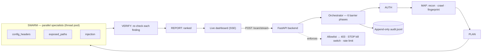

# VulnSwarm — Swarmageddon

A consent-first, non-destructive, allowlist-gated multi-agent web-vulnerability scanner. A swarm of specialist agents maps a target you own, probes it in parallel, re-verifies every finding against a fresh observation, and streams a ranked report to a live dashboard.

**It detects. It does not exploit.** Probes are small, deterministic markers (a reflected token, a single quote, `;id`, a traversal to `/etc/passwd`) used only to confirm that a weakness exists. The planner refuses to inject into destructive or sensitive fields (password, token, CSRF, delete/update/create/logout controls).

## Tech stack

- **Backend:** Python 3, FastAPI + Uvicorn, Pydantic.
- **HTTP probing:** Python standard-library `urllib` only (no third-party scraper); every request is paced and allowlist-checked.
- **Concurrency:** `ThreadPoolExecutor` runs the specialist swarm in parallel over one shared `ScanContext`.
- **Streaming:** Server-Sent Events push every phase, agent and finding to the dashboard live.
- **Frontend:** a single-file vanilla HTML/CSS/JS dashboard — no build step.
- **Optional triage:** `openai` SDK pointed at a Featherless hosted model (off unless `FEATHERLESS_API_KEY` is set).
- **Storage:** an append-only JSONL audit log. No database.
- **Tests:** `pytest` (26 test functions).

## Architecture



## Pipeline

`backend/orchestrator.py` runs six phases as barriers. Each phase finishes before the next starts.

| Phase  | Module(s) | What happens |
|--------|-----------|--------------|
| AUTH   | `auth.py`, `recon.py` | One shared session. Logs in if the target is recognized (currently DVWA, lab creds from env). |
| MAP    | `recon.py`, `crawler.py`, `fingerprint.py` | Root recon, bounded same-host BFS crawl (pages, forms, params, no JS execution), evidence-based stack fingerprint. |
| PLAN   | `planner.py` | Pairs discovered sections with relevant specialists to produce work units (stack-aware, capped at 20 injection units). |
| SWARM  | `agents/config_headers.py`, `agents/exposed_paths.py`, `agents/injection.py` | Units run in parallel (thread pool, `MAX_WORKERS = 8`), all writing to one shared `ScanContext`. |
| VERIFY | `verifier.py` | Re-checks each finding on a fresh request: `confirmed`, `rejected`, or `unverified` (left for a human). |
| REPORT | `reporter.py` | Dedupes, assigns stable ids, ranks by verdict, then severity, then source (deterministic first). |

Specialists:
- **config_headers**: missing security headers, insecure cookies, version banners.
- **exposed_paths**: sensitive paths that are actually reachable. A random-path baseline, file-type checks, and content signatures suppress catch-all false positives (e.g. Juice Shop answers 200 for any path).
- **injection**: reflected XSS, error-based and boolean-blind SQLi, command injection, and LFI on one form field or query parameter.

## Safety guardrails

- **Server-side allowlist** (`ALLOWLIST` in `main.py`): an off-list host gets HTTP 403 and is never fetched. `/scan/stream` re-checks the allowlist inside the worker thread before calling the orchestrator. `GET /preview` returns a placeholder for off-list hosts without contacting them and does not follow redirects.
- **Kill switch** (`control.py`): `POST /scan/stop` with a `run_id` stops one scan; `all: true` (or no `run_id`) stops every in-flight scan. The stop flag is checked before every outbound request, so a stop takes effect mid-phase. A client disconnect also stops the scan.
- **Concurrency cap and pacing** (env vars):
  - `VULNSWARM_MAX_CONCURRENT_SCANS`: default `2`. Additional scans get HTTP 429.
  - `VULNSWARM_REQUEST_INTERVAL_MS`: default `50`. Minimum gap between requests within one scan.
  - `VULNSWARM_GLOBAL_REQUEST_INTERVAL_MS`: default `25`. Minimum gap between any two requests.
- **Append-only audit log** (`audit.py`): JSONL, one record per line, never rewritten. It records scan start, stop, reject, and outcome events, plus each outbound request (method, URL, status). Request bodies are not stored. Default path is `backend/var/audit.jsonl`; override it with `VULNSWARM_AUDIT_LOG`. `GET /audit` returns the newest records and the live limits.

## Triage: rule-based by default

All findings come from deterministic checks, and each carries a machine-checkable `check` that the verifier re-runs. **The scanner and the full test suite run rule-based.**

`backend/llm.py` is an **optional** hosted-LLM augmentation (Featherless, OpenAI-compatible; default model `Qwen/Qwen2.5-7B-Instruct`, override with `VULNSWARM_MODEL`). It is gated behind `llm.available()` and stays **off unless `FEATHERLESS_API_KEY` is set**. When it is on, it only triages header and cookie data the scanner already collected. The verifier grounds every AI finding by rejecting any whose cited evidence is not in the real response. The report's `ai_available` field shows whether it was active.

## API

| Endpoint | Purpose |
|----------|---------|
| `POST /auth/login` | Returns a bearer token (HMAC-signed, 8 h TTL; secret from `VULNSWARM_SESSION_SECRET`) |
| `POST /scan` | Blocking: runs the swarm and returns the finished report |
| `POST /scan/stream` | Same swarm, streamed as SSE: `scan_started`, `phase`, `agent`, `finding`, `verdict`, `scan_complete`, `error` |
| `POST /scan/stop` | Kill switch (one scan or all scans) |
| `GET /preview` | Allowlist-gated target preview for the dashboard |
| `GET /targets`, `/audit`, `/me`, `/health` | Lab targets, audit tail and limits, current user, liveness |

## Run it

```bash
cd backend
python -m venv .venv && source .venv/bin/activate
pip install -r requirements.txt
uvicorn main:app --port 8000
```

Open `dashboard/index.html`, sign in as `erwin@local` / `demo` (or `andrew@local` / `demo`), set the target, and press **SCAN**.

Tests (26 test functions in `backend/tests/`):

```bash
cd backend && python -m pytest tests/ -q
```

The demo users and the dev token secret are for localhost only. Set `VULNSWARM_SESSION_SECRET` and replace `USERS` before any shared use. Optionally set `VULNSWARM_CORS_ORIGINS` (comma-separated) to lock CORS to your dashboard origins; the default allows localhost/127.0.0.1 dashboard ports and a `file://` open (`null` origin).

## Demo targets

The intended targets are intentionally vulnerable apps that **you host yourself**: **OWASP Juice Shop** and **DVWA**. Both require **Docker** locally. `docker-compose.yml` runs them alongside the backend and dashboard:

- Juice Shop on `:3001`
- DVWA on `:8081`
- backend on `:8000`
- dashboard on `:8090`

Add your host to `ALLOWLIST` (default: `localhost`, `127.0.0.1`, `10.0.0.32`) and to `LAB_TARGETS` in `main.py`. Keep these apps off the public internet. Scan only systems you own or are explicitly authorized to test.

## Data & sources

Swarmageddon uses **no external datasets**. Its only inputs are the live HTTP responses of the single target you host and have consented to test; nothing is collected or trained on. Demo targets are the intentionally vulnerable **OWASP Juice Shop** and **DVWA** (upstream open-source projects you run locally via `docker-compose` — see **Demo targets**). The server-side allowlist guarantees no host outside your own lab is ever contacted.

## Known limitations & next steps

**Limitations today**
- The crawl does not execute JavaScript, so SPA-only routes and DOM-rendered links can be missed.
- Injection is capped at 20 work units per run to stay fast and polite.
- A fixed specialist set: security headers / cookies / version banners, reachable sensitive paths, and reflected XSS + SQLi + command injection + LFI on one field at a time.
- **Confirmation probes only** — it proves a weakness exists, it does not exploit, chain, or extract data.
- Authenticated scanning currently recognizes the DVWA login flow only.

**Next steps**
- Headless-browser crawl for single-page apps.
- More specialists: SSRF, IDOR, broken auth/session, CORS misconfig.
- Verifier-grounded LLM triage across more finding types.
- SARIF / shareable HTML report export.
- Scheduled re-scans with diffing to track a target over time.

## Team ALANI

- Andrew Carvajal
- Erwin **[LAST NAME — TODO]**
